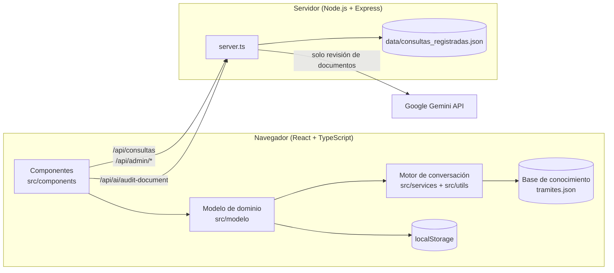
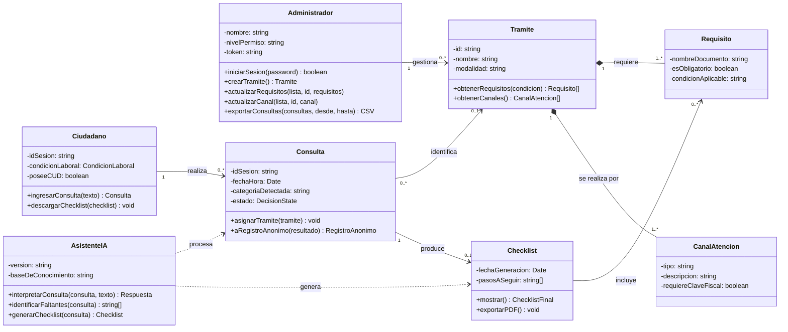
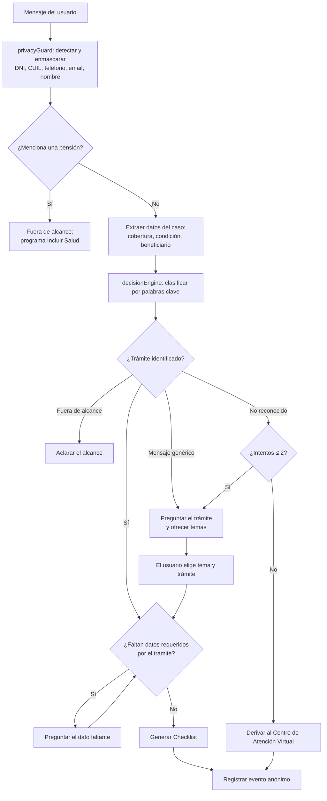

# Orienta IA

Asistente web que orienta a las personas sobre trámites de obras sociales y empresas de medicina prepaga ante la **Superintendencia de Servicios de Salud (SSSalud)** de Argentina. A partir de una descripción en lenguaje natural, identifica el trámite que corresponde, solicita los datos mínimos del caso y genera un **checklist de documentación** con los canales oficiales de presentación.

Trabajo práctico integrador de la materia *Desarrollo de Sistemas de Inteligencia Artificial* · Tecnicatura Superior en Ciencia de Datos e Inteligencia Artificial · IFTS N.º 12.

> **Aviso:** proyecto académico. No es un servicio oficial de la SSSalud, no recibe reclamos y no almacena datos personales. La información de trámites debe contrastarse con [argentina.gob.ar/sssalud](https://www.argentina.gob.ar/sssalud).

---

## Contenido
1. [Funcionalidades](#funcionalidades)
2. [Historias de usuario](#historias-de-usuario)
3. [Funcionalidad de IA](#funcionalidad-de-ia)
4. [Stack tecnológico](#stack-tecnológico)
5. [Arquitectura](#arquitectura)
6. [Estructura del repositorio](#estructura-del-repositorio)
7. [Modelo de dominio](#modelo-de-dominio)
8. [Motor de conversación](#motor-de-conversación)
9. [Datos](#datos)
10. [API del servidor](#api-del-servidor)
11. [Privacidad y seguridad](#privacidad-y-seguridad)
12. [Instalación y ejecución](#instalación-y-ejecución)
13. [Pruebas](#pruebas)
14. [Uso de IA en el desarrollo](#uso-de-ia-en-el-desarrollo)
15. [Historial del repositorio](#historial-del-repositorio)
16. [Limitaciones y trabajo futuro](#limitaciones-y-trabajo-futuro)
17. [Diagramas UML](#diagramas-uml)
18. [Autores](#autores)

---

## Funcionalidades

La aplicación tiene dos perfiles.

### Ciudadano (acceso anónimo, sin registro)
- **Asistente:** chat en lenguaje natural que identifica el trámite, pregunta los datos faltantes (tipo de cobertura, condición laboral, beneficiario) y genera el checklist.
- **Mi checklist:** documentación requerida, pasos a seguir y canales de presentación, con opción de imprimir o guardar en PDF.
- **Redactor de nota:** genera un modelo de nota formal dirigida a la obra social o prepaga.
- **Herramientas IA:** revisión orientativa de una receta u orden médica (firma, matrícula, diagnóstico, fecha) usando Gemini.
- **Canales de contacto:** canales oficiales de la SSSalud (Trámites a Distancia, atención presencial con turno, Centro de Atención Virtual).

### Administrador de contenidos (requiere autenticación)
- **Panel del organismo:** métricas agregadas de consultas con filtros por mes, provincia, tipo de entidad y trámite, aplicando k-anonimato.
- **Consultas:** registro anónimo de las consultas reales, exportable a CSV.
- **Gestión de trámites:** alta de trámites y edición de requisitos y canales; exporta un nuevo `tramites.json`.

---

## Historias de usuario

Cada funcionalidad responde a una historia de usuario. La HU 9 es la funcionalidad de inteligencia artificial.

| HU | Historia | Funcionalidad | Código principal |
|---|---|---|---|
| 1 | Describir el problema en lenguaje cotidiano y que el asistente identifique el trámite | Asistente (motor de reglas) | `ChatInterface.tsx`, `orientaEngine.ts`, `decisionEngine.ts` |
| 2 | Requisitos para denuncia por cobertura prestacional | Asistente y Mi checklist | `tramites.json`, `ChecklistView.tsx` |
| 3 | Requisitos para reclamos de discapacidad con CUD | Asistente y Mi checklist | `tramites.json`, `ChecklistView.tsx` |
| 4 | Requisitos para unificar o desunificar aportes | Asistente y Mi checklist | `tramites.json`, `ChecklistView.tsx` |
| 5 | Checklist para imprimir o guardar en PDF | Mi checklist | `ChecklistView.tsx`, `modelo/Checklist.ts` |
| 6 | Actualizar los requisitos de un trámite | Gestión de trámites | `admin/GestionTramites.tsx` |
| 7 | Dar de alta un trámite nuevo | Gestión de trámites | `admin/GestionTramites.tsx` |
| 8 | Saber si el trámite es online o requiere Clave Fiscal o turno | Mi checklist y Canales de contacto | `ChecklistView.tsx`, `CanalesModal.tsx` |
| **9** | **Revisar una receta u orden médica con IA antes de presentarla** | **Herramientas IA (Gemini)** | **`AiToolsModal.tsx`, `server.ts` (`/api/ai/audit-document`)** |
| 10 | Generar la nota del reclamo | Redactor de nota | `ciudadano/RedactorNota.tsx` |
| 11 | Ver estadísticas anónimas y descargarlas en CSV | Panel del organismo y Consultas | `admin/PanelOrganismo.tsx`, `admin/ConsultasRegistradas.tsx` |

---

## Funcionalidad de IA

**Revisar receta (HU 9)** usa la API de Google Gemini para revisar una receta u orden médica antes de presentarla.

1. El ciudadano sube una imagen y, si quiere, un texto en *Herramientas IA* (`AiToolsModal.tsx`).
2. El navegador la envía a `POST /api/ai/audit-document`. La API key nunca llega al navegador.
3. El servidor enmascara datos personales del texto y llama a Gemini con una instrucción de sistema que le pide no transcribir datos personales, `temperature: 0.2` y una respuesta en JSON con esquema fijo.
4. Gemini devuelve `tipoDocumento`, `estado`, `observacionesPositivas`, `elementosFaltantes` y `recomendacionCiudadana`, que la pantalla muestra.
5. Si Gemini responde `503` o `429`, el servidor reintenta y, si está configurado, usa `GEMINI_MODEL_RESPALDO`. Si sigue sin responder, aplica una revisión por palabras clave (cuando hay texto) o muestra un mensaje claro, sin que la app se rompa.

En el planteo inicial, Gemini también clasificaba las consultas del chat. Durante las pruebas dio errores `503` (alta demanda) y `404` (modelo no disponible), por lo que el chat pasó a un motor de reglas y Gemini quedó dedicado a la revisión de recetas.

---

## Stack tecnológico

| Capa | Tecnología |
|---|---|
| Lenguaje | **TypeScript** (front-end y back-end) |
| Front-end | **React 19**, **Tailwind CSS 4**, íconos `lucide-react` |
| Build / dev server | **Vite** |
| Back-end | **Node.js** + **Express** (`server.ts`, ejecutado con `tsx`) |
| Persistencia | Archivos **JSON** (base de conocimiento y registro de consultas) y `localStorage` del navegador |
| IA generativa | **Google Gemini** vía `@google/genai` (solo para la revisión de documentos) |
| Plataforma de desarrollo | Google AI Studio |

### Decisiones de diseño
- **TypeScript en ambas capas.** La interfaz web se ejecuta en el navegador, donde el lenguaje nativo es JavaScript; TypeScript agrega tipado estático y soporte completo de programación orientada a objetos (clases, modificadores de acceso, interfaces). Usar el mismo lenguaje en el servidor permite compartir tipos y simplifica el proyecto.
- **Motor de reglas en lugar de un LLM para la conversación.** El asistente identifica el trámite con reglas y preguntas guiadas sobre una base de conocimiento curada. Esto garantiza que los requisitos informados provengan siempre de la base (sin alucinaciones), que las respuestas sean reproducibles y que el servicio funcione sin depender de una API externa. La IA generativa se reserva para una tarea donde aporta valor y el riesgo es acotado: la revisión de documentos.
- **Archivos JSON en lugar de un motor de base de datos.** Para el alcance del prototipo (11 trámites y un registro anónimo de eventos), un archivo JSON es suficiente, legible y versionable. El modelo de dominio está desacoplado del origen de los datos, de modo que migrar a una base de datos no requiere cambiar las clases.

---

## Arquitectura



- La lógica de orientación (identificación del trámite, datos faltantes y armado del checklist) se ejecuta **en el cliente**, a partir de la base de conocimiento empaquetada con la aplicación.
- El **servidor** se encarga de la autenticación del administrador, el registro anónimo de consultas y la comunicación con Gemini, para que la API key nunca llegue al navegador.
- En modo desarrollo, `server.ts` monta Vite como middleware. En producción, sirve los archivos compilados de `dist/`.

---

## Estructura del repositorio

```
.
├── server.ts                     Servidor Express: API, autenticación, registro, Gemini
├── index.html                    Punto de entrada HTML
├── vite.config.ts                Configuración de Vite (React, Tailwind, PWA)
├── package.json
├── .env.example                  Variables de entorno de referencia
├── docs/diagramas/               Diagramas UML (clases, casos de uso, objetos)
├── public/                       Recursos estáticos (logo, íconos, manifest)
└── src/
    ├── main.tsx                  Montaje de React
    ├── App.tsx                   Composición de la app y cambio de perfil ciudadano/administrador
    ├── types.ts                  Tipos de la interfaz (mensajes, checklist para la vista)
    ├── modelo/                   Modelo de dominio (una clase por archivo)
    │   ├── Ciudadano.ts
    │   ├── Administrador.ts
    │   ├── AsistenteIA.ts
    │   ├── Consulta.ts
    │   ├── Tramite.ts
    │   ├── Requisito.ts
    │   ├── CanalAtencion.ts
    │   ├── Checklist.ts
    │   └── index.ts
    ├── services/
    │   ├── orientaEngine.ts      Orquestación de la conversación
    │   └── chatService.ts        Cliente de la revisión de documentos
    ├── utils/
    │   ├── decisionEngine.ts     Reglas de clasificación y preguntas por trámite
    │   └── privacyGuard.ts       Detección y enmascarado de datos personales
    ├── data/
    │   ├── canalesContacto.ts    Enlaces y datos de contacto oficiales
    │   └── db/
    │       ├── tramites.json         Base de conocimiento (11 trámites)
    │       ├── tramitesData.ts       Acceso a la base y ediciones del administrador
    │       ├── types.ts              Tipos de la base de conocimiento
    │       ├── consultasSimuladas.ts 2.000 consultas simuladas para el panel
    │       └── simulatedData.ts      Cálculo de métricas, k-anonimato y registro local
    └── components/
        ├── ChatInterface.tsx     Chat del asistente
        ├── ChecklistView.tsx     Vista e impresión del checklist
        ├── TrackingPills.tsx     Barra de datos mínimos del caso
        ├── AiToolsModal.tsx      Revisión de documentos con IA
        ├── CanalesModal.tsx      Canales de contacto
        ├── LoginView.tsx         Autenticación del administrador
        ├── Header.tsx, ReglaDeOroBanner.tsx, SplashScreen.tsx, OrientaLogo.tsx, ...
        ├── ciudadano/
        │   └── RedactorNota.tsx
        └── admin/
            ├── PanelOrganismo.tsx
            ├── ConsultasRegistradas.tsx
            └── GestionTramites.tsx
```

---

## Modelo de dominio

El paquete `src/modelo/` implementa el diagrama de clases. Cada clase encapsula su estado con atributos `private` y expone su comportamiento mediante métodos públicos.



*Versión resumida. El diagrama completo, con todos los atributos y métodos, está en [`docs/diagramas`](docs/diagramas).*

| Clase | Responsabilidad | Usada en |
|---|---|---|
| `Ciudadano` | Usuario anónimo, identificado por un `idSesion` aleatorio por pestaña. Inicia consultas y descarga el checklist. | `App.tsx`, `ChatInterface.tsx` |
| `Administrador` | Único usuario autenticado. Gestiona la base de trámites y exporta el registro de consultas. | `LoginView.tsx`, `GestionTramites.tsx`, `ConsultasRegistradas.tsx` |
| `AsistenteIA` | Fachada del motor de conversación: interpreta mensajes, detecta datos faltantes y genera el checklist. | `ChatInterface.tsx`, `App.tsx` |
| `Consulta` | Una conversación: estado, trámite identificado y conversión a registro anónimo. | `ChatInterface.tsx` |
| `Tramite` | Trámite de la base de conocimiento; compone sus requisitos y canales. | `Consulta`, `Checklist` |
| `Requisito` | Documento requerido, obligatoriedad y condición a la que aplica. | `Tramite`, `Checklist` |
| `CanalAtencion` | Canal virtual, presencial o de seguimiento. | `Tramite`, `Checklist` |
| `Checklist` | Requisitos aplicables a la condición de la persona y pasos a seguir; se presenta en la vista y se exporta a PDF. | `ChecklistView.tsx` |

Ejemplo de uso:

```typescript
import { AsistenteIA, Ciudadano } from './modelo';

const ciudadano = new Ciudadano();
const asistente = new AsistenteIA();

const consulta = ciudadano.ingresarConsulta('Quiero cambiarme de obra social');
const respuesta = await asistente.interpretarConsulta(consulta, 'Quiero cambiarme de obra social');
// respuesta.text → "¿Cuál es tu condición o situación laboral actual?"

await asistente.interpretarConsulta(ciudadano.ingresarConsulta('Monotributo'), 'Monotributo');
const checklist = asistente.generarChecklist(consulta);
// checklist → requisitos comunes de "opcion_cambio" + los específicos de monotributo
```

---

## Motor de conversación

El motor se implementa en `services/orientaEngine.ts` (orquestación) y `utils/decisionEngine.ts` (reglas por trámite). `AsistenteIA` lo expone al resto de la aplicación.



Comportamiento principal:
- **Clasificación:** reglas de palabras clave normalizadas (sin tildes ni mayúsculas) para cada trámite, con desambiguación cuando dos trámites son similares (por ejemplo, negativa de afiliación vs. aumento por edad).
- **Datos faltantes:** cada trámite declara en `datos_a_preguntar` qué datos necesita (`tipo_entidad`, `situacion`, `grupo_familiar`). El motor pregunta solo los que faltan y reutiliza los que el usuario ya mencionó en mensajes anteriores.
- **Preguntas guiadas:** si no reconoce la consulta, ofrece los temas de la base (`macro_categoria`) y luego los trámites del tema elegido.
- **Derivación:** solo deriva al canal oficial después de dos intentos fallidos con mensajes concretos, o si el usuario indica que su caso no está en la lista. Los saludos y los mensajes que contienen solo datos personales nunca derivan.
- **Checklist:** `Tramite.obtenerRequisitos(condicion)` combina los requisitos comunes con los específicos de la condición laboral, y `Checklist` los agrupa en documentación general, médica y laboral.

---

## Datos

### Base de conocimiento — `src/data/db/tramites.json`
Contiene 11 trámites elaborados a partir de documentación pública de la SSSalud. Esquema de cada registro:

```jsonc
{
  "id": "opcion_cambio",                 // identificador único
  "nombre": "Opción de cambio / libre elección del Agente del Seguro",
  "tipo": "tramite_online",              // denuncia | tramite | tramite_online | reclamo_especial
  "macro_categoria": "Opción de cambio", // tema usado en las preguntas guiadas
  "en_mvp": true,
  "descripcion": "...",
  "ejemplos_usuario": ["Quiero cambiarme de obra social"],
  "datos_a_preguntar": ["situacion"],    // tipo_entidad | situacion | grupo_familiar
  "requisitos": {
    "comunes": ["Clave Fiscal nivel 3 (usuario ARCA)", "..."],
    "por_situacion": { "monotributista": ["..."] }
  },
  "canal": { "virtual": "...", "presencial": "...", "seguimiento": "..." },
  "notas": "...",
  "fuente": "..."
}
```

Las ediciones hechas desde **Gestión de trámites** se guardan en el `localStorage` del administrador y se aplican de inmediato. Para publicarlas, se exporta el JSON y se reemplaza este archivo.

### Registro de consultas
Cada consulta finalizada genera un evento anónimo con este esquema:

| Campo | Ejemplo |
|---|---|
| `fecha` | `2026-11-05` |
| `tramite_detectado` | `opcion_cambio` |
| `resultado` | `Respondida` · `Derivada al canal oficial` · `Aclaró su alcance` |
| `condicion` | `Monotributo` |
| `tipo_entidad` | `Obra social` |
| `entidad`, `provincia`, `rango_edad` | Valores genéricos o `No informa` |
| `mes` | `2026-11` |

Los eventos se envían a `POST /api/consultas` y se persisten en `data/consultas_registradas.json`, con una copia en el `localStorage` del navegador.

### Datos simulados — `src/data/db/consultasSimuladas.ts`
2.000 eventos sintéticos con entidades ficticias ("Obra social A", "Prepaga B", etc.) para alimentar el panel. Se almacenan codificados en un formato compacto: cada registro ocupa 9 caracteres en base 36, que representan los días desde la fecha base más índices sobre listas de valores.

---

## API del servidor

| Método | Ruta | Auth | Descripción |
|---|---|---|---|
| `GET` | `/api/health` | — | Estado del servicio y modelo de IA configurado. |
| `POST` | `/api/ai/audit-document` | — | Revisión orientativa de un documento. Body: `{ documentBase64?, mimeType?, documentText?, tipoTramite? }`. Si Gemini no responde y se envió texto, aplica una revisión por palabras clave. |
| `POST` | `/api/consultas` | — | Registra un evento anónimo. Solo acepta los campos del esquema; rechaza resultados inválidos con `400`. |
| `POST` | `/api/admin/login` | — | Body: `{ password }`. Devuelve `{ token, nombre }`. `401` si es incorrecta; `429` tras 5 intentos fallidos. |
| `GET` | `/api/admin/verificar` | Bearer | Valida el token. |
| `POST` | `/api/admin/logout` | Bearer | Invalida el token. |
| `GET` | `/api/admin/consultas` | Bearer | Devuelve `{ total, consultas }` con el registro completo. |

---

## Privacidad y seguridad

- **Sin datos personales:** el ciudadano no se registra. `privacyGuard.ts` detecta DNI, CUIL/CUIT, teléfono, email, nombre y número de afiliado, muestra un aviso y enmascara los valores antes de procesarlos.
- **Registro anónimo:** el servidor solo acepta campos categóricos predefinidos; el texto de la conversación nunca se envía ni se almacena.
- **k-anonimato (k = 10):** el panel oculta cualquier agrupación con menos de 10 eventos, también en la exportación.
- **Autenticación del administrador:** la contraseña se compara en el servidor contra `ADMIN_PASSWORD` mediante una comparación en tiempo constante (hash SHA-256 + `timingSafeEqual`). Se emite un token aleatorio de 24 bytes con vigencia de 8 horas, y se bloquea la IP durante 5 minutos tras 5 intentos fallidos.
- **API key de Gemini:** solo vive en el servidor. Los textos enviados a Gemini se enmascaran previamente.

---

## Instalación y ejecución

### Requisitos
- Node.js 20 o superior
- Una API key de Google Gemini (solo necesaria para la revisión de documentos)

### Variables de entorno
Copiar `.env.example` a `.env` y completar:

| Variable | Obligatoria | Descripción |
|---|---|---|
| `ADMIN_PASSWORD` | Sí | Contraseña del administrador. Sin ella, el acceso de administrador queda deshabilitado. |
| `GEMINI_API_KEY` | Para la IA | API key de Gemini. Sin ella la app funciona, pero no la revisión de recetas (HU 9). |
| `GEMINI_MODEL` | No | Modelo principal (por defecto `gemini-3.8-flash`). |
| `GEMINI_MODEL_RESPALDO` | No | Modelo alternativo si el principal responde `503`/`429`. |
| `PORT` | No | Puerto del servidor (por defecto `3000`). |

### Comandos
```bash
npm install          # instalar dependencias
npm run dev          # servidor de desarrollo en http://localhost:3000
npm run lint         # verificación de tipos (tsc --noEmit)
npm run build        # compilar el front-end en dist/
NODE_ENV=production npm start   # servir la versión compilada
```

En **Google AI Studio**, las variables se cargan en *Settings → Secrets*.

> Nunca subas el archivo `.env` con la clave real: el `.gitignore` ya lo excluye.

---

## Pruebas

Cada versión se probó en la vista previa de Google AI Studio: pruebas funcionales manuales, exploratorias y de regresión, pruebas end-to-end con Playwright contra un servidor de prueba y validación del contenido por una integrante que trabaja en la SSSalud. El plan, los casos de la funcionalidad de IA, los casos límite y el registro de los 10 bugs corregidos están en el informe de entrega. `npm run lint` verifica los tipos de TypeScript.

---

## Uso de IA en el desarrollo

| Parte | Herramienta | Qué revisó o ajustó el equipo |
|---|---|---|
| Historias de usuario y criterios Gherkin | ChatGPT / Gemini | Alcance y tipos de usuario reales |
| Prototipo HTML y mockup (`prototipos/`) | ChatGPT | Pantallas y flujo, base del diseño final |
| Aplicación web | Google AI Studio | Cada versión se probó y se pidieron cambios |
| Base de trámites, clases de `src/modelo`, unificación de versiones, login seguro, filtro de privacidad, reintentos de Gemini y README | Claude | Requisitos validados contra fuentes de la SSSalud; cada cambio se probó en AI Studio |
| Diagramas UML y pruebas end-to-end | Claude | Diagramas alineados con el código; resultados confirmados a mano |

La mayor parte del código se generó con asistencia de IA. El equipo definió qué construir, aportó el conocimiento de la SSSalud, probó cada versión y decidió qué cambiar.

---

## Historial del repositorio

El historial se armó subiendo en orden las versiones guardadas del proyecto, de la más antigua a la más reciente. La fecha original de cada versión figura en el mensaje de su commit. Los dos primeros prototipos en HTML se conservan en `prototipos/`.

---

## Limitaciones y trabajo futuro

**Limitaciones**
- La base de conocimiento es académica y cubre 11 trámites. Algunos códigos de TAD figuran como "a confirmar".
- El motor de reglas cubre las formulaciones más frecuentes. Ante expresiones no previstas, recurre a preguntas guiadas y no a comprensión semántica.
- La persistencia en archivos no es apta para producción: en entornos efímeros, como el despliegue de AI Studio, el registro del servidor puede perderse al redesplegar.
- Las sesiones de administrador se guardan en memoria del servidor y se pierden al reiniciarlo.

**Trabajo futuro**
- Migrar `tramites.json` y el registro de consultas a una base de datos (por ejemplo PostgreSQL o Firestore).
- Incorporar un clasificador entrenado con las consultas registradas para complementar las reglas, manteniendo la base como única fuente de requisitos.
- Completar los códigos de trámite TAD que figuran "a confirmar". La base ya fue revisada por una integrante que trabaja en la SSSalud (05/11/2026).
- Agregar pruebas automatizadas del motor de reglas.

> El repositorio conserva archivos heredados del prototipo original que no forman parte de esta versión: empaquetado de escritorio y Android (`electron/`, `electron-builder.json`, `android/`, `capacitor.config.ts`, `scripts/generate_installers.py`), e instalación como PWA (`src/components/PWAInstallButton.tsx`, `dev-dist/`).

---

## Diagramas UML

Disponibles en [`docs/diagramas`](docs/diagramas):

| Diagrama | Archivo |
|---|---|
| Clases | [`Orienta_IA_Diagrama_Clases_v3.png`](docs/diagramas/Orienta_IA_Diagrama_Clases_v3.png) |
| Casos de uso | [`Orienta_IA_Diagrama_Casos_v3.png`](docs/diagramas/Orienta_IA_Diagrama_Casos_v3.png) |
| Objetos | [`Orienta_IA_Diagrama_Objetos_v3.png`](docs/diagramas/Orienta_IA_Diagrama_Objetos_v3.png) |

---

## Autores

Grupo N.º 4 · Tecnicatura Superior en Ciencia de Datos e Inteligencia Artificial · IFTS N.º 12.

- Sandra Avalos
- Azul Galeano Cheij
- Mariana Ríos Insaurralde
- Juan Manuel Nuñez
- Keimar Suarez
